<p align="center">
  <picture>
    <source media="(prefers-color-scheme: dark)" srcset="./assets/inkwisp-logo-dark.png">
    
  </picture>
</p>

<p align="center">
  <picture>
    <source media="(max-width: 600px)" srcset="./assets/inkwisp-celestial-header-mobile.svg">
    
  </picture>
</p>

<p align="center">
  嵌入式系统　/　Linux　/　IoT　/　边缘计算
</p>

## 从一块板开始

我是 **Inkwisp**，专注嵌入式系统与边缘设备。

从原理图、板级调试和固件开始，逐步连接驱动、协议、Linux 与应用。我关心软硬件各层如何协同，让设备稳定运行、便于定位问题，也能持续扩展。

```text
inkwisp@lab:~$ trace --from board --to application
硬件 ── 固件 ── 协议 ── Linux / Edge ── 应用
每一段都可测量、可调试、可维护。
```

## 工作范围

<p align="center">
  <picture>
    <source media="(max-width: 600px)" srcset="./assets/inkwisp-system-orbit-mobile.svg">
    
  </picture>
</p>

## 常用技术

| 工程方向 | 技术与工具 |
| :--- | :--- |
| **MCU 与实时系统** | `C` `C++` `STM32` `ESP32` `51 MCU` `ARM Cortex-M` `FreeRTOS` |
| **Linux 与工具链** | `Embedded Linux` `Linux` `Shell` `GCC` `CMake` `Git` |
| **通信与协议** | `UART` `SPI` `I²C` `CAN` `TCP/IP` `UDP` `MQTT` `Modbus` `Wi-Fi` `Bluetooth` |
| **设备应用** | `Qt` `Android` `Kotlin` `Python` `Vue` |
| **电路与板卡** | `原理图` `PCB` `EasyEDA / 嘉立创EDA` `硬件调试` |

## 项目航线

项目会随整理逐步补充。当前可在 [Ink-Wisp 的公开仓库](https://github.com/Ink-Wisp?tab=repositories) 查看已发布内容。

<!--
新增真实项目时，复制下面这一段并移出注释：

### 项目名称

一句话说明它解决了什么真实问题。

`硬件或平台` · `核心技术` · `协议或应用`

**工程链路：** Hardware → Firmware → Protocol → Application  
**仓库：** [查看项目](https://github.com/Ink-Wisp/REPOSITORY)
-->

<details>
<summary><strong>项目档案会记录什么</strong></summary>

项目条目说明实际问题、软硬件链路、关键技术与当前状态。新增时复制上面的项目块即可。

</details>

## 继续连接

代码、实验记录与项目进度以公开仓库为准。

<p align="center">
  <a href="https://github.com/Ink-Wisp">个人主页</a>
  &nbsp;&nbsp;·&nbsp;&nbsp;
  <a href="https://github.com/Ink-Wisp?tab=repositories">公开仓库</a>
</p>

<p align="center">
  <picture>
    <source media="(max-width: 600px)" srcset="./assets/inkwisp-celestial-footer-mobile.svg">
    
  </picture>
</p>
